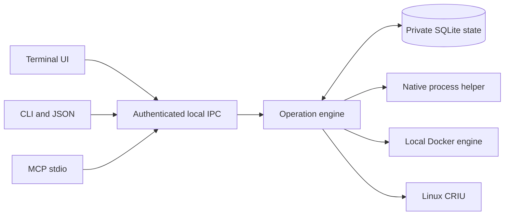

# Architecture, security, and recovery

The daemon serializes mutations and journals pending effects and outcomes. POSIX uses a socket in a user-owned 0700 directory or loopback when the state path exceeds the socket system limit. Windows uses loopback and an endpoint file in a directory with a restricted user and SYSTEM ACL. Both transports authenticate each connection and its request and response using fresh nonces and HMAC. There is no HTTP management surface. Same-account programs that can read state are inside the trust boundary. The daemon performs no elevation, firewall edits, service installation, or workload downloads. A user-approved command executes with that user's permissions.

## Scope and metrics

Candidates combine process metadata, manifest paths, executable metadata, ancestry, and TCP listeners where observable. They are observations. Adoption records exact process identities after review. Native launches use a staged handshake to record identity before allowing application execution. Linux opens PID file descriptors for process control. macOS rechecks the process creation identity and uses a task audit token. Windows checks a process handle and creation time and groups managed descendants in a Job Object. Read the primary references for [Linux pidfds](https://man7.org/linux/man-pages/man2/pidfd_send_signal.2.html), [cgroup v2](https://docs.kernel.org/admin-guide/cgroup-v2.html), [macOS process interfaces](https://github.com/apple-oss-distributions/xnu/blob/main/bsd/sys/proc_info.h), and [Windows Job Objects](https://learn.microsoft.com/en-us/windows/win32/procthread/job-objects).

CPU is sampled as percent of one logical core. Resident-memory figures sum observed process RSS and can count shared pages more than once. A project dependency is listed by reference. Compose services referenced by multiple projects are treated as shared. Listening port results describe the authorized TCP scan. An absent result can also indicate an out-of-scope listener.

One canonical directory currently maps to one durable project. Nearby monorepo manifests can produce separate discovery groups. Detached or reparented processes can remain outside verified containment and may require individual review. The current process scan provides no reliable historical command reconstruction. The systemd adapter supports explicit Linux user services and timers. macOS launchd, Windows Service Control Manager and Task Scheduler, cron, and other external supervisors still require separate lifecycle management.

## Recovering a workload

1. Run `projectfreeze history` or `projectfreeze operation ID` to see the recorded intent and completed effects.
2. Run `projectfreeze inspect PROJECT` and `projectfreeze reconcile PROJECT` to verify identities and current state.
3. If a freeze completed partially, `projectfreeze resume PROJECT` releases recorded ProjectFreeze suspensions. A process that was already suspended is left for its original owner. After an interruption during an unrecorded effect, inspect the pending step before taking manual action.
4. If shutdown was partial, inspect which resources remain and retry the reviewed action. Verify that any stopped dependency is safe to restart before wake. A successful wake checks TCP readiness when configured. Application-level recovery may also require credential, connection, timer, and pending I/O checks.

Daemon restart preserves workloads and state. A changed boot identity invalidates old process identities. A package upgrade should stop the daemon, install the verified package, and start it against the same state directory. Keep recoverable metadata and the old package until reconciliation succeeds.

## Checkpoints

The native adapter invokes [Linux CRIU](https://github.com/checkpoint-restore/criu) with `check`, `dump`, and `restore`. Docker delegates to the local [Docker checkpoint CLI](https://docs.docker.com/reference/cli/docker/checkpoint/). Docker images stay under the original container's engine-managed checkpoint directory, which must be readable for integrity checks. The capture can contain process memory and secrets. The manifest records image hashes, backend version, scope, and host prerequisites. Restore requires the original project and a compatible backend and host. The current implementation restricts restore to the original boot. Successful capture depends on CRIU permissions, kernel support, capture scope, and backing files. A checkpoint does not roll back external side effects or guarantee surviving network sessions. Windows and macOS native operation use freeze/resume and sleep/wake. The candidate provides no VM snapshot integration.

The Docker checkpoint adapter requires a workload already configured for host networking. Isolated network namespaces hit an [upstream restore failure](https://github.com/moby/moby/issues/50750) on the tested engine. Keep the existing isolation and use pause/unpause or stop/start for those containers. ProjectFreeze never changes a container's network mode.
